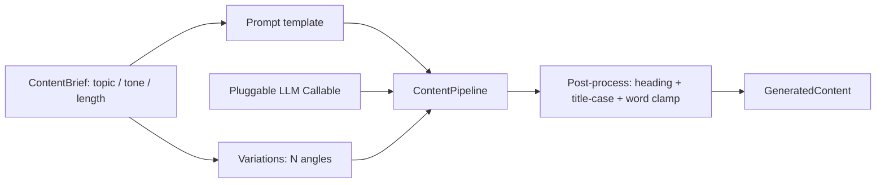

<p align="center">
  
</p>

<h1 align="center">AI Content Generator</h1>

<p align="center">
  <strong>Template-driven content pipeline with a pluggable LLM and deterministic post-processing — in Python.</strong><br>
  Write a brief, plug in any LLM, generate on-brand variations, and clamp them to your word-count rules.
</p>

<p align="center">
  <em>Built and maintained by <a href="https://viprasol.com">Viprasol Tech</a> — Fintech Experts. Full-Stack Builders.</em>
</p>

<p align="center">
  <a href="https://github.com/Viprasol-Tech/ai-content-generator/actions/workflows/ci.yml"></a>
  <a href="LICENSE"></a>
  
  <a href="https://t.me/viprasol_help"></a>
  <a href="https://github.com/Viprasol-Tech/ai-content-generator/stargazers"></a>
</p>

---

> **Provider-agnostic and offline-capable.** The LLM is just a `Callable[[str], str]` you supply.
> A built-in deterministic **fake LLM** ships with the package, so the demo and the entire test
> suite run with **no API keys and no network**. Swap in OpenAI, Anthropic, or a local model in one line.

> **Note:** This is a clean, well-tested reference implementation — not production-hardened. Review before use.

## Features

- **Pluggable LLM** — pass any `Callable[[str], str]`; no SDK lock-in, no hard dependencies on model vendors.
- **Offline fake provider** — deterministic, hash-based `FakeLLM` for demos, CI, and reproducible tests.
- **Real prompt templating** — `str.format`-style templates rendered from a structured `ContentBrief`.
- **Deterministic post-processing** — heading split, smart title-casing, and word-count clamping.
- **N variations from one brief** — each variation gets a distinct, index-derived creative angle.
- **CLI** — `ai-content-generator demo` runs the whole pipeline offline.
- **Modern tooling** — ruff, mypy (strict), pytest, GitHub Actions CI.

## Quickstart

```bash
git clone https://github.com/Viprasol-Tech/ai-content-generator.git
cd ai-content-generator
python -m pip install -e ".[dev]"

# Generate a few variations offline with the built-in fake LLM:
ai-content-generator demo --topic "our new analytics dashboard" --count 3
ai-content-generator demo --tone playful --max-words 30
```

## Plug in a real provider

The pipeline only needs a function from prompt to text. Wrap any model you like:

```python
from ai_content_generator.models import ContentBrief, Tone
from ai_content_generator.variations import generate_variations


def my_llm(prompt: str) -> str:
    # e.g. call OpenAI, Anthropic, or a local server here and return the text.
    # from openai import OpenAI
    # client = OpenAI()
    # resp = client.chat.completions.create(
    #     model="gpt-4o-mini",
    #     messages=[{"role": "user", "content": prompt}],
    # )
    # return resp.choices[0].message.content or ""
    return "Heading\n\nReal generated body text..."


brief = ContentBrief(
    topic="our new analytics dashboard",
    tone=Tone.PROFESSIONAL,
    min_words=40,
    max_words=120,
    audience="busy product teams",
    keywords=["insights", "fast", "no-code"],
)

for item in generate_variations(brief, my_llm, count=3):
    print(item.heading, "-", item.word_count, "words")
    print(item.body)
```

## Architecture



## Roadmap

- [x] Pluggable LLM interface + offline deterministic fake provider
- [x] Brief-driven prompt templating + post-processing pipeline
- [x] N deterministic variations per brief
- [ ] Built-in adapters for popular hosted LLMs
- [ ] Tone/readability scoring and keyword-coverage checks
- [ ] Batch briefs from CSV/JSON and export to Markdown

## Contributing

PRs welcome — see [CONTRIBUTING.md](CONTRIBUTING.md) and our [Code of Conduct](CODE_OF_CONDUCT.md).

## Contact — Viprasol Tech Private Limited

- Website: [viprasol.com](https://viprasol.com)
- Email: [support@viprasol.com](mailto:support@viprasol.com)
- Telegram: [t.me/viprasol_help](https://t.me/viprasol_help) | WhatsApp: +91 96336 52112
- GitHub: [@Viprasol-Tech](https://github.com/Viprasol-Tech) | [LinkedIn](https://www.linkedin.com/in/viprasol/) | X [@viprasol](https://twitter.com/viprasol)

## License

[MIT](LICENSE) (c) 2025 Viprasol Tech Private Limited
